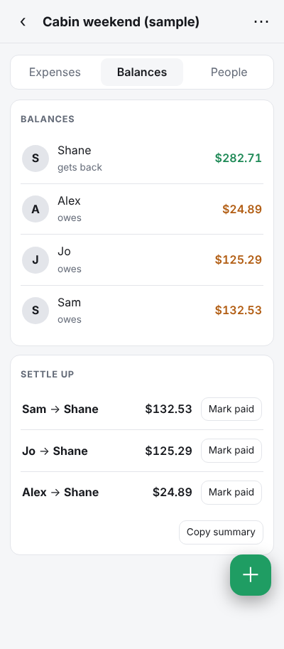

# Tabby — split expenses, offline

Tabby keeps track of shared costs — trips, roommates, dinners — and tells everyone the fewest payments needed to get square.



- **No account, no server.** Everything is stored on the device (localStorage). Export/import a JSON backup from the ⋯ menu.
- **Installable & offline.** It's a PWA: "Add to Home Screen" on Android/iOS, works with no connection.
- **Exact money math.** Amounts are integer cents; splits always add up to the penny (leftover cents are assigned deterministically).
- **Split equally or by shares** (e.g. 2 shares for someone who brought a partner), and leave people out of an expense.
- **Settle up** suggests at most *n − 1* payments; "Mark paid" records them. "Copy summary" gives a text you can paste into a group chat.
- People can only be removed once their balance is zero, so no money silently disappears.

## Run it

It's plain HTML/CSS/JS — no build step, no dependencies.

```bash
npm start            # serves src/ at http://localhost:5173
```

## Test

```bash
npm test             # unit tests for the money logic (incl. a 300-group fuzz test)
python3 tests/e2e.py # real-browser end-to-end test (needs: pip install playwright)
```

GitHub Actions runs both on every push.

## Deploy (Netlify)

Connect the repo — `netlify.toml` already sets the publish dir to `src` and runs the unit tests as the build step, so a failing test blocks a deploy.

## Layout

```
src/core.js     pure logic (parsing, splitting, balances, settle-up, validation)
src/app.js      UI, storage, routing
src/sw.js       offline service worker
tests/          unit + e2e tests
```
